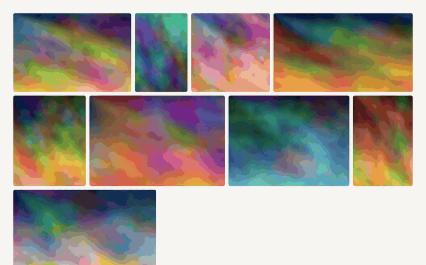

<p align="center">
  <picture>
    <source media="(prefers-color-scheme: dark)" srcset="./assets/logo/logo-dark.svg" />
    
  </picture>
</p>

# liftbox

[](https://github.com/esdrassantos06/liftbox/actions/workflows/ci.yml)
[](https://www.npmjs.com/package/liftbox)
[](./LICENSE)
[](https://github.com/esdrassantos06/liftbox)

**[Documentation and live demos](https://liftbox.digital)** · [Try it on StackBlitz](https://stackblitz.com/github/esdrassantos06/liftbox/tree/main/examples/vite?file=src%2FGallery.jsx) · [Comparison with other React lightboxes](https://liftbox.digital/docs/comparison)

A React lightbox that opens each photo out of the thumbnail you clicked, even a cropped one, and flies it back on close. Zoom, video, thumbnails, slideshow and masonry or justified grids ship in one MIT package with zero runtime dependencies; you can swap every string, icon, color and timing, and it works with any grid you already have.

<p align="center">
  
</p>

Using liftbox? A star on GitHub is how the next person searching for a React lightbox finds it.

## Features

- Open and close animation from your thumbnail, with a zoom and fade fallback.
- Arrows, keyboard, swipe and flick navigation, with `slide`, `fade` and `zoom` transitions.
- Thumbnail strip or pager dots, zoom (wheel, pinch, double tap, buttons, keys), pinch to close, fullscreen, rotation, flip, sharing and downloads.
- A toolbar that moves what does not fit into an accessible "More options" menu, controls that fade out when idle, and right-to-left layouts.
- Native video with captions, YouTube and Vimeo without their player scripts, any page in an iframe, and room for [custom players](https://liftbox.digital/docs/custom-players) such as Video.js 10.
- Slideshow that pauses when the user takes over.
- AVIF, WebP and art-directed crops through `<picture>` sources on image slides.
- Fast with thousands of images and videos: the current image loads first with its thumbnail as a placeholder, preloading adapts to slow connections, and the thumbnail strip, pager and grids render only what is in view.
- Optional [justified, masonry and uniform grids](https://liftbox.digital/docs/grids) and a [category filter](https://liftbox.digital/docs/filter), each usable with or without the lightbox.
- Deep links through the URL hash with `useLightboxHash`, by number or by slide name, closed by the back button.
- Modal dialog semantics, focus trap and return, a live region, reduced motion and a scroll lock that keeps the page still.
- Server-rendering safe, ready for the Next.js App Router.
- Styled with `--eg-*` CSS variables. The lightbox needs no `'unsafe-inline'` in a Content Security Policy.

## Compared with other React lightboxes

|                            | liftbox                     | yet-another-react-lightbox | PhotoSwipe | lightGallery               |
| -------------------------- | --------------------------- | -------------------------- | ---------- | -------------------------- |
| License                    | MIT                         | MIT                        | MIT        | GPL-3.0 or a paid license  |
| Opens out of the thumbnail | Yes, also cropped ones      | No                         | Yes        | Yes, cropped with a plugin |
| Grids                      | Masonry, justified, uniform | Separate package           | No         | Justified                  |
| Zoom, thumbnails, video    | Built in                    | One plugin each            | Zoom only  | One plugin each            |
| YouTube and Vimeo          | Built in                    | No                         | No         | Plugin                     |

Measured bundle sizes, pinned versions, sources and an accessibility table are on the [comparison page](https://liftbox.digital/docs/comparison), with migration guides from [yet-another-react-lightbox](https://liftbox.digital/docs/migration), [lightGallery](https://liftbox.digital/docs/migration-lightgallery) and [PhotoSwipe](https://liftbox.digital/docs/vs-photoswipe).

## Installation

```bash
npm install liftbox
```

```ts
import "liftbox/styles.css";
```

React 18 or 19 is a peer dependency. The package is ESM only and ships TypeScript declarations.

## Quick start

The lightbox is controlled: you own `open` and `index`, it tells you when the user wants to change them. Keep it mounted so the close animation can play.

```tsx
import { useRef, useState } from "react";
import { Lightbox, type Slide } from "liftbox";
import "liftbox/styles.css";

const slides: Slide[] = [
  {
    src: "/photos/harbour.jpg",
    width: 1600,
    height: 1067,
    alt: "Boats in the harbour",
    title: "Harbour",
  },
  // ...
];

export function Gallery() {
  const [index, setIndex] = useState(-1);
  const thumbnails = useRef<(HTMLButtonElement | null)[]>([]);

  return (
    <>
      {slides.map((slide, i) => (
        <button
          key={slide.src}
          ref={(el) => {
            thumbnails.current[i] = el;
          }}
          onClick={() => setIndex(i)}
          aria-label={`Open ${slide.alt}`}
        >
          
        </button>
      ))}

      <Lightbox
        slides={slides}
        open={index >= 0}
        index={Math.max(index, 0)}
        onIndexChange={setIndex}
        onClose={() => setIndex(-1)}
        getThumbnail={(i) => thumbnails.current[i]}
      />
    </>
  );
}
```

## Documentation

The full documentation, with live demos on every page, is at **[liftbox.digital](https://liftbox.digital/docs)**.

| Topic           | Pages                                                                                                                                                                                                                                                                                                                                                                                                                                                                                                                                                                                                                                                                                                                                                                                                                                                                                                                                                                                    |
| --------------- | ---------------------------------------------------------------------------------------------------------------------------------------------------------------------------------------------------------------------------------------------------------------------------------------------------------------------------------------------------------------------------------------------------------------------------------------------------------------------------------------------------------------------------------------------------------------------------------------------------------------------------------------------------------------------------------------------------------------------------------------------------------------------------------------------------------------------------------------------------------------------------------------------------------------------------------------------------------------------------------------- |
| Getting started | [Installation](https://liftbox.digital/docs/installation), [Quick start](https://liftbox.digital/docs/quick-start), [Next.js App Router](https://liftbox.digital/docs/nextjs), [Server rendering](https://liftbox.digital/docs/ssr)                                                                                                                                                                                                                                                                                                                                                                                                                                                                                                                                                                                                                                                                                                                                                      |
| Features        | [Slides](https://liftbox.digital/docs/slides), [Navigation and gestures](https://liftbox.digital/docs/navigation), [Thumbnails](https://liftbox.digital/docs/thumbnails), [Pager dots](https://liftbox.digital/docs/pager), [Zoom](https://liftbox.digital/docs/zoom), [Fullscreen](https://liftbox.digital/docs/fullscreen), [Slideshow](https://liftbox.digital/docs/slideshow), [Deep linking](https://liftbox.digital/docs/deep-linking), [Rotation](https://liftbox.digital/docs/rotation), [Flip](https://liftbox.digital/docs/flip), [Download](https://liftbox.digital/docs/download), [Share](https://liftbox.digital/docs/share), [Toolbar and overflow menu](https://liftbox.digital/docs/toolbar), [Idle controls](https://liftbox.digital/docs/idle), [Right-to-left](https://liftbox.digital/docs/rtl), [Custom players](https://liftbox.digital/docs/custom-players), [Grids](https://liftbox.digital/docs/grids), [Category filter](https://liftbox.digital/docs/filter) |
| Customising     | [Labels and i18n](https://liftbox.digital/docs/labels), [Icons](https://liftbox.digital/docs/icons), [Render overrides](https://liftbox.digital/docs/render), [Styling](https://liftbox.digital/docs/styling), [Class names and data attributes](https://liftbox.digital/docs/class-names)                                                                                                                                                                                                                                                                                                                                                                                                                                                                                                                                                                                                                                                                                               |
| Reference       | [Lightbox props](https://liftbox.digital/docs/lightbox-props), [Slide](https://liftbox.digital/docs/slide), [Exports](https://liftbox.digital/docs/exports)                                                                                                                                                                                                                                                                                                                                                                                                                                                                                                                                                                                                                                                                                                                                                                                                                              |
| Guides          | [Accessibility](https://liftbox.digital/docs/accessibility), [Content Security Policy](https://liftbox.digital/docs/csp), [Performance](https://liftbox.digital/docs/performance), [Bundle size](https://liftbox.digital/docs/bundle-size), [Comparison](https://liftbox.digital/docs/comparison), [Migrating from yet-another-react-lightbox](https://liftbox.digital/docs/migration), [Migrating from lightGallery](https://liftbox.digital/docs/migration-lightgallery), [liftbox vs PhotoSwipe](https://liftbox.digital/docs/vs-photoswipe)                                                                                                                                                                                                                                                                                                                                                                                                                                          |

The source of the docs lives in [`docs/`](./docs), and the prop tables there are generated from [`src/types.ts`](./src/types.ts).

## Bundle size

[](https://bundlejs.com/?q=liftbox&treeshake=[{Lightbox}])
[](https://bundlejs.com/?q=liftbox)

Minified and gzipped by [bundlejs](https://bundlejs.com) from the version on npm, React excluded. The [Bundle size](https://liftbox.digital/docs/bundle-size) page lists every entry, minified and brotli-compressed with `npm run size` each time the docs are built.

## Development

| Script                  | What it does                                      |
| ----------------------- | ------------------------------------------------- |
| `npm run dev`           | Playground on Vite, also used by the e2e tests    |
| `npm run test`          | Unit and integration tests (Vitest, jsdom)        |
| `npm run e2e`           | Playwright on desktop Chrome and Pixel 7          |
| `npm run typecheck`     | TypeScript, including isolated declaration checks |
| `npm run lint`          | ESLint with React Hooks and jsx-a11y              |
| `npm run build`         | ESM bundle, declarations and stylesheet in `dist` |
| `npm run size`          | Bundle size                                       |
| `npm run check:package` | publint and Are the Types Wrong                   |

The public site, with the docs and demos, lives in [`docs/`](./docs) (Next.js and Fumadocs) and has its own scripts: `npm run dev --prefix docs` and `npm run build --prefix docs`. It runs as a Next.js server on Vercel, with `docs` as the project's root directory. [`docs/proxy.ts`](./docs/proxy.ts) gives every page a fresh nonce and a Content Security Policy with `default-src 'self'` that trusts only scripts and style tags carrying that nonce.

## Migrating from @esdrassantos06/gallery

This package was published as `@esdrassantos06/gallery` until 1.2.0. Moving over takes one install and two import paths: the API, class names and `--eg-*` variables did not change.

## Contributing

Contributions are welcome. Read [CONTRIBUTING.md](./CONTRIBUTING.md) and the [Code of Conduct](./CODE_OF_CONDUCT.md), and report vulnerabilities as described in [SECURITY.md](./SECURITY.md). Changes are listed in [CHANGELOG.md](./CHANGELOG.md).

## License

[MIT](./LICENSE). The justified layout math is adapted from opengallery and the built-in icons are from [Mynaui Icons](https://mynaui.com/icons), both MIT. Their notices are in [NOTICE](./NOTICE).
